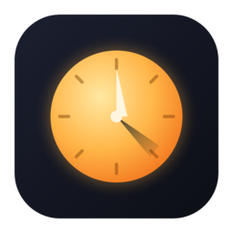
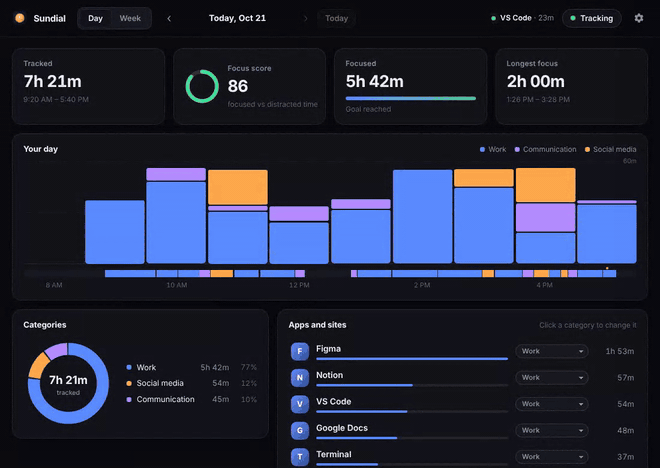
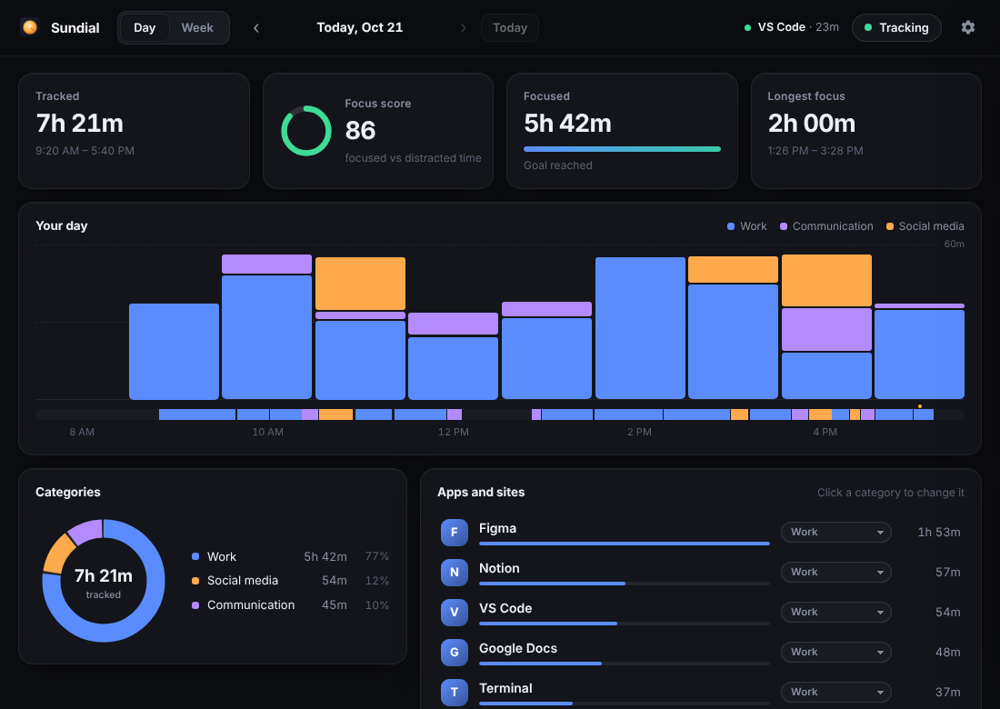
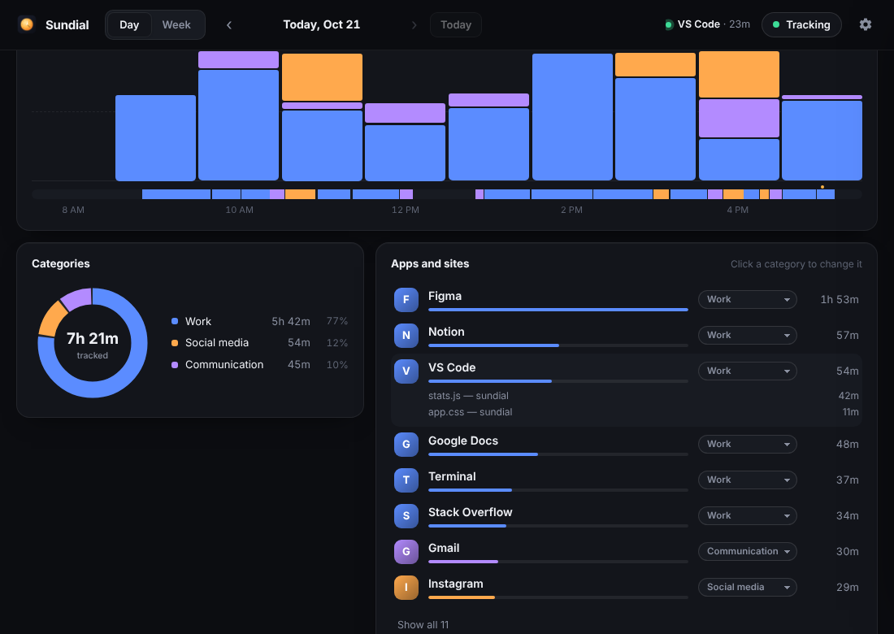
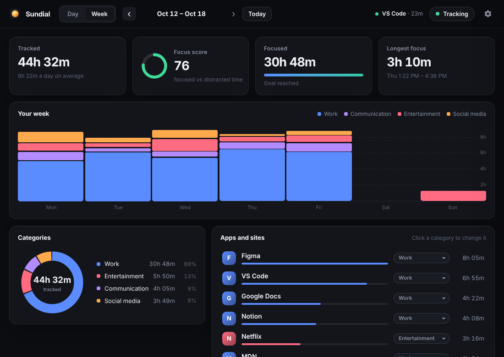
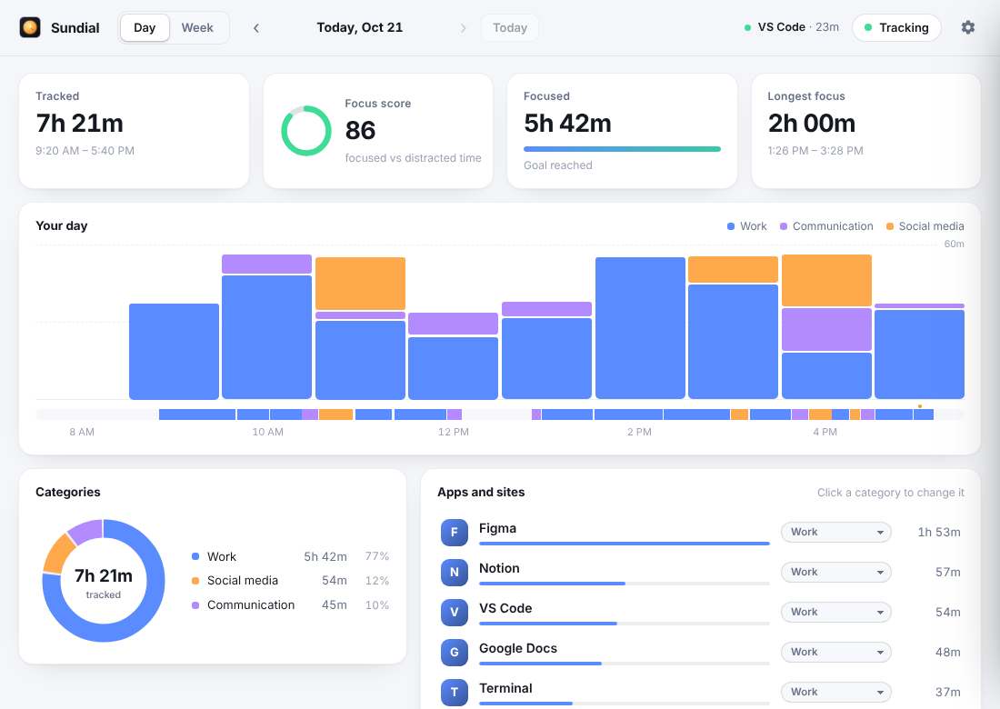
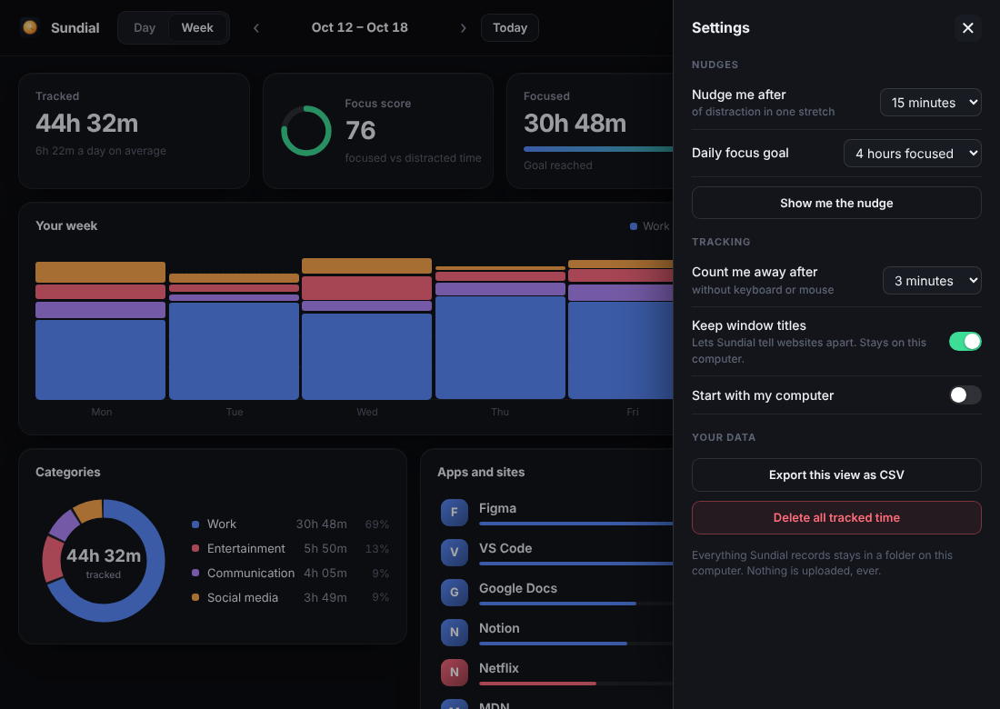
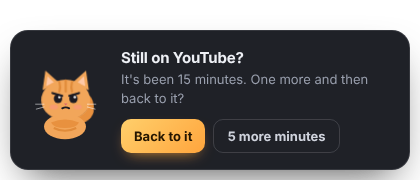
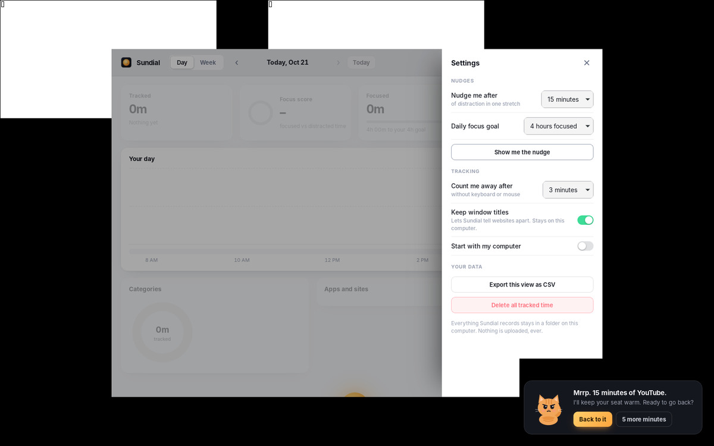

<div align="center">



# Sundial

**See where your day went.**
Sundial notes which app and website you're using, all on its own, and turns your day into a clear timeline: time per app and site, focus versus distraction, and your longest stretch of real work. Drift into YouTube for too long and a small cat politely asks if you'd like to get back to it.
It's free and open source, with no account and no subscription. Nothing ever leaves your computer.

Windows · macOS · Linux



[Demo video (MP4)](docs/demo.mp4) · [Install](#install) · [What it does](#what-it-does) · [Compared to paid trackers](#compared-to-paid-time-trackers)

</div>

---

## Install

**Windows** (PowerShell, installs for your user only, no admin needed):

```powershell
irm https://raw.githubusercontent.com/llamaboi55/sundial/main/scripts/install.ps1 | iex
```

**macOS and Linux:**

```sh
curl -fsSL https://raw.githubusercontent.com/llamaboi55/sundial/main/scripts/install.sh | sh
```

Both commands download the latest release from GitHub and install it. Files fetched this way don't get flagged, so you won't see an "unknown publisher" warning. To update, run the same command again. You can also download the installer for your system from [Releases](https://github.com/llamaboi55/sundial/releases/latest).

**Build it yourself.** You need [Rust](https://rustup.rs) and Node.js 18 or later. On Linux you also need the [Tauri packages](https://tauri.app/start/prerequisites/).

```sh
git clone https://github.com/llamaboi55/sundial && cd sundial && npm install && npm run build
```

**Just look at it** (no install): run `npm run preview`, then open the printed address. It shows the dashboard with a pretend week of data.

## What it does

- **Tracks itself.** There are no timers to start. Every two seconds Sundial notes which app is in front and the title of its window. When you step away from the keyboard and mouse for 3 minutes (you can change this), that time isn't counted.
- **Knows websites.** In a browser, Sundial reads the site from the tab title, so YouTube, GitHub, Reddit and Google Docs each show up as their own line instead of one big "Chrome".
- **Your day at a glance:**
  - an hour-by-hour chart coloured by category
  - a fine timeline of every switch, which you can hover for details
  - totals by category
  - your top apps and sites; click one to see which windows or pages took the time
- **Focus score.** This is the share of your focused time out of focused plus distracted time. Chat, email and other neutral time doesn't count either way.
- **Longest focus.** Sundial finds your best uninterrupted stretch of work. A quick glance at chat doesn't break it; a long detour does.
- **Daily goal.** Set how many focused hours you're aiming for and watch the bar fill up.
- **Week view.** It shows your days side by side, the daily average, and your best focus stretch of the week.
- **Categories you control.** Sundial starts with sensible categories:
  - Work
  - Learning
  - Communication
  - Entertainment
  - Social media
  - Shopping
  - Other

  Change any app or site with one click on its category and it stays changed.
- **The nudge cat.** After 15 minutes of distraction in one stretch (or 5, 10, 20, 30, 45 or 60 minutes, or never), a cat slides in from the corner. Click **Back to it** to get a happy cat, or **5 more minutes** to have it wait.
- **Pause** from the tray, either for an hour or until you resume. Pausing is handy for anything you'd rather not have recorded.
- **Export** any day or week as a CSV file. You can also delete everything with one button.
- Light and dark themes follow your system. Sundial can start with your computer.

| | |
|---|---|
|  |  |
|  |  |
|  |  |

Running on Linux, with real windows being tracked and the nudge card in the corner:



## Compared to paid time trackers

| | Sundial | Typical paid tracker |
|---|---|---|
| Price | Free | Subscription |
| Windows, macOS and Linux | ✅ | Mac and Windows |
| Automatic, no timers | ✅ | ✅ |
| Websites told apart | ✅ (from tab titles) | ✅ |
| Timeline, categories, focus score | ✅ | ✅ |
| Nudge when you drift | ✅ the cat | some |
| Works offline, data stays on your computer | ✅ always | often uploaded to their servers |
| Needs an account | No | Usually |
| AI summaries | ❌ (simple rules you can edit instead) | some |
| Open source | ✅ | ❌ |

## Privacy

Everything Sundial records is a list of "app, window title, start, end" lines. They're saved as plain text files in Sundial's own folder on your computer:

- Windows: `%APPDATA%\io.github.llamaboi55.sundial\sessions`
- macOS: `~/Library/Application Support/io.github.llamaboi55.sundial/sessions`
- Linux: `~/.local/share/io.github.llamaboi55.sundial/sessions`

Sundial makes no network connections. It never takes screenshots, logs keystrokes or reads page contents. If you'd rather not keep window titles at all, turn off **Keep window titles** in Settings and only app names are saved.

## Good to know

- **macOS** only shares the name of the app in front, not window titles, without a screen-recording permission that Sundial doesn't ask for. On a Mac you'll see "Safari" or "Chrome" rather than each site. App tracking, categories, the nudge and everything else work the same.
- **Linux** works on X11 desktops, and on Wayland desktops for apps running through XWayland. Native Wayland apps don't share the window in front, so they show up as time away.
- **Away time.** When the keyboard and mouse have been idle for the time you choose, Sundial stops counting from your last touch. Watching a long video without touching anything counts as away once that limit passes; raise the limit in Settings if you'd rather count it.

## Development

```sh
npm install
npm run preview      # the dashboard in a browser with a pretend week, no Rust build needed
npm run dev          # the real app with hot reload
npm test             # names, sites, stats, nudge and settings tests (node --test) and Rust tests
```

- `src-tauri/src/active.rs`: which app and window is in front, on each system (tested)
- `src-tauri/src/tracker.rs`: turning samples into sessions, idle time, checkpoints (tested)
- `src-tauri/src/store.rs`: saving sessions as JSON lines, one file per day (tested)
- `src/js/names.js`: friendly app names and sites from browser titles (tested)
- `src/js/categories.js` and `src/js/stats.js`: categories, totals, focus score, charts data, CSV (tested)
- `src/js/nudger.js`: when the cat speaks up (tested)
- `src/js/app.js` and `src/js/nudge.js`: the dashboard and the nudge card

GitHub Actions builds releases for all three systems whenever the version in `src-tauri/tauri.conf.json` changes on `main`.

## Where the idea came from

Found through this Instagram Reel: https://www.instagram.com/p/Dc1GL8ZuJrz/ (and another one: https://www.instagram.com/p/DcsueUhKSzN/)
This project isn't affiliated with Drifty or any app shown there.

## License

MIT. Sundial is an independent project and isn't affiliated with Drifty.
